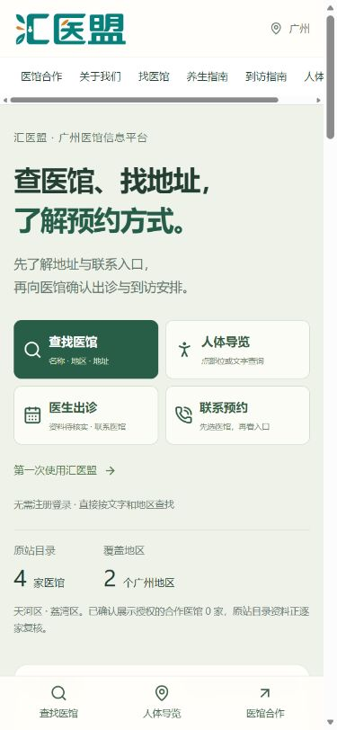
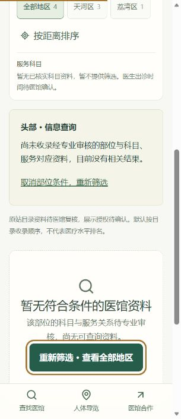
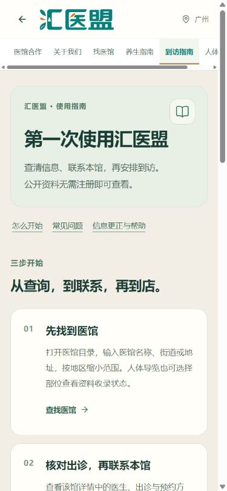

# 第一次使用汇医盟：查医馆、找地址、了解预约方式

> **编辑状态：公众号图文草稿，尚未发布。** 本文件的链接由统一配置占位符生成，发布前运行 `pnpm prepare:wechat`，使用 `docs/wechat/generated/first-use-article.md` 完整地址版本。审核确认网页已上线、链接可打开及医馆展示授权后再发布。编辑说明与配图说明不复制到用户正文。当前只沿用原网站四条目录记录，不能写成“5家已认证合作医馆”。

**建议摘要**：不知道从哪里开始？先选医馆，再核对地址、出诊与预约渠道。人体导览和文字查询都能找到入口。

**封面与配图**：使用原版汇医盟 Logo 和本轮实际手机页面截图。缺少可确认的汇医堂原版 Logo，不绘制替代；不使用无授权医生肖像、其他平台截图或疗效对比图。已有截图见下方配图表；新版页面应在正式部署后重截。

---

以下为图文正文草稿。

欢迎来到汇医盟🌿

汇医盟是面向广州的中医医馆信息平台。你可以查找医馆、了解地址与联系方式，并查看已经提供的预约入口。浏览和查询不需要注册登录。

页面截图用于说明操作，实际查询请使用已配置的公众号菜单或下方入口地址。

第一次使用，可以从“查找医馆”开始：https://www.huiyimeng.com/clinics.html?entry=wechat_article

## 1. 先选一家医馆

在医馆目录输入医馆名称或地址，也可以按已收录的地区筛选。点进医馆详情后，先核对名称、所在区域、实际接诊地址和电话，再决定如何联系。

目前目录沿用原网站的四条广州医馆记录：汇医堂中医诊所、岭海医疗诊所、培元堂中医诊所、易安中医诊所。目录记录、合作展示授权和资料核实是不同的状态，请以各馆页面的说明为准。

查找医馆：https://www.huiyimeng.com/clinics.html?entry=wechat_article

## 2. 想从人体导览开始，也可以

打开人体导览后，可以点选部位，也可以使用文字部位入口。选中状态会给出反馈，并进入相应的查询状态；没有收录资料时，会明确显示空结果，可以取消条件、重新筛选或查看全部医馆。

目前尚无完成专业审核的“部位—科目或服务”对应资料，因此人体入口暂不会给出某个部位对应哪些治疗或哪家医馆的结论。部位选择不是诊断，也不表示某种治疗适合你。

人体导览：https://www.huiyimeng.com/body-guide.html?entry=wechat_article

如果模型加载失败或手机操作不方便，直接使用文字入口和医馆目录即可。

## 3. 看医生出诊时，分清时间与地点

医馆营业时间与医生出诊时间需要分别确认。某家医馆营业，并不表示你想看的医生当天在诊；同一位医生在不同医馆出诊时，也需要分别核对日期和地点。

目前尚无完成核实并获得展示授权的医生和排班资料，出诊页面会显示待确认状态。请通过所选医馆的电话确认医生姓名、出诊日期、接诊地点，以及是否需要提前联系。

医生与出诊状态：https://www.huiyimeng.com/doctors.html?entry=wechat_article

## 4. 联系预约：先选医馆，再走本馆渠道

在“联系预约”页选择医馆，页面会展示该馆已有的联系方式。

汇医堂保留原网站的微信小程序预约入口和原二维码；小程序是否仍有效、微信内外如何打开，需要以本馆确认及手机实际测试为准。无法拉起时，可按页面说明尝试在微信中识别原二维码，或使用该馆电话咨询。

其他医馆当前没有已提供的线上预约码，可通过本馆电话咨询出诊和预约安排。

发送“预约”、打开网页或点击拨号，都不代表预约成功。到诊时间、医生及接诊地点，以医馆或其预约系统的明确确认为准。平台当前没有保存患者预约记录的服务。

选择医馆并联系：https://www.huiyimeng.com/appointment.html?entry=wechat_article

## 5. 到店前，再核对一次地址

打开位置列表，先选择医馆，再核对本馆地址与地图入口。导航是出行辅助，第一次到访前建议向医馆确认当前实际接诊地点。

岭海医疗诊所的原资料包含两个地址，当前接诊地点待确认，因此暂不提供有歧义的导航。请先使用该馆电话核实，避免走错地点。

到店位置与导航：https://www.huiyimeng.com/locations.html?entry=wechat_article

## 6. 费用和预约变更，联系谁

诊疗费用由具体医馆确认。当前资料尚未提供经医馆确认的现行诊疗价目，咨询时可了解项目、计价单位、适用条件和是否还有其他收费。平台医馆合作方案的费用属于医馆经营合作费用，不是患者诊疗价格。

需要改期或取消预约，请联系原预约医馆或在原预约系统内处理。公众号的关键词回复只提供入口，不会代你修改预约，也不表示已经接通人工。

医馆目录：https://www.huiyimeng.com/clinics.html?entry=wechat_article

## 7. 分享一家医馆，用它自己的页面

从医馆详情页复制本馆分享链接，可以直接分享该馆资料和联系方式。接收人打开后优先看到这家医馆，也可以主动进入公共目录查看其他医馆。

不要把汇医堂的预约小程序二维码当成所有医馆通用码，也不要把一家医馆的电话、地址或预约方式套到另一家。

## 8. 记住这几个关键词

回复【导览】，打开人体导览；

回复【医馆】，查找医馆；

回复【预约】，选择医馆并查看联系预约方式；

回复【出诊】，查看医生与排班的核实状态；

回复【导航】，先选医馆再核对到店位置；

回复【合作】，了解医馆平台合作；

回复【帮助】，查看平台帮助渠道。

【】内是要发送的关键词提示，普通文字不是可点击按钮。请单独发送完整关键词；菜单开放后，也可从底部菜单进入。

## 9. 资料有变化，欢迎反馈

平台帮助可处理网页使用、资料更正、意见反馈与医馆合作。原网站机构电话为 17819754219，号码待再次确认，平台接待时间待确认。

平台帮助：https://www.huiyimeng.com/support.html?entry=wechat_article

医生出诊、健康问题、诊疗费用和预约变更，请联系相应医馆或接诊医师。当前没有已接入的全站统计；电话点击、实际咨询、确认预约和到店是不同的事实，不能互相替代。

完整使用指南：https://www.huiyimeng.com/service-guide.html?entry=wechat_article

医馆合作：https://www.huiyimeng.com/cooperation.html?entry=wechat_article

---

以下为编辑与维护说明，不纳入用户正文。

## 配图表

| 位置    | 建议素材                                                         | 图片说明与发布前核对                                             |
| ------- | ---------------------------------------------------------------- | ---------------------------------------------------------------- |
| 封面    | `public/huiyimeng-brand-user.jpg` 原版品牌素材，配清晰文字标题   | 保持 Logo 原貌；不要拿未经确认的机构资质、医生肖像作背书         |
| 第 1 节 | `docs/previews/wechat/home-mobile-390.jpg` 本轮首页截图          | 裁去浏览器和个人信息，正文仍保留可读操作说明与真实链接           |
| 第 2 节 | `docs/previews/body-empty-mobile-320.jpg` 或本轮人体文字入口截图 | 展示选中反馈与空结果，不拼接诊断或疗效判断                       |
| 第 4 节 | `docs/previews/clinic-mobile-390.png` 或本轮本馆联系区截图       | 核对截图中馆名、电话和预约入口是一家医馆；不将图片按钮当实际交互 |
| 第 9 节 | `docs/previews/wechat/service-guide-mobile-390.jpg` 本轮使用指南 | 正式接待时间未确认前，不在图片上写在线、秒回或全天客服           |

## 发布前逐项确认

1. 此稿属于“平台使用指南”，不是中医知识科普；不添加疾病判断、疗效承诺或按身体部位推荐特定医馆的句子。
2. 用生成后的完整地址版本；实际打开每个链接，确认静态 `.html` 页面直开、刷新正常。若网页尚未上线，只在内部预览，不向用户发送未发布的页面地址。
3. 四家展示授权和资料状态由业务方逐项核验，未取得授权不能把本文当成合作背书；医馆数量从统一数据读取，不根据业务背景手写“5家”。
4. 医生、排班、营业时间、费用仍无已核实数据时，保留正文相应空态说明；不能为了填满文章补充示例资料。
5. 汇医堂如需在另篇服务介绍中涉及代煎，使用业务方本次明确的“免费代煎，不送药”；该说明仅属于汇医堂，不扩大到其他医馆。适用范围与有效期仍需本馆确认。
6. 后台菜单、关键词与欢迎回复配置完成并经真实账号验证后，再核对文中的菜单和关键词引导；当前交付稿不等于已生效。
7. 发布人员核对公众号主体、账号资质、图文发布权限及相应医疗科普/医馆推广要求；免责声明不能代替具体内容审核。
8. 核对本账号图文正文外链和“阅读原文”等入口的实际能力。不能假设普通网址文字或截图中的按钮可点击；未开放正文链接时，按后台实际能力设置“阅读原文”为完整使用指南，并保留关键词与菜单指引。三张配图使用本文实际截图，需在编辑器上传原图，不把本机路径粘贴为线上图片地址。

文案依据：本次用户业务说明、`content/clinics-source.json`、`lib/clinics.ts` 及现有页面。2026-10-24 为技术整理日期，不是医馆业务核实日期。负责人、审核人、批准日期与发布记录待实际填写。
